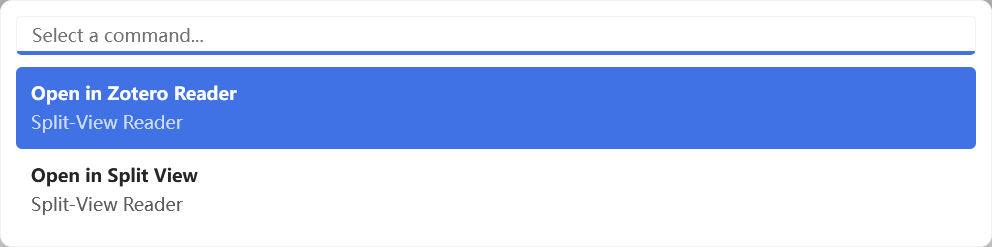
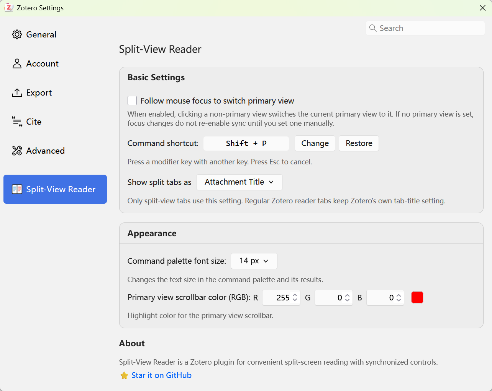

#  Split-View Reader

[English](README.md) | [简体中文](doc/README-zhCN.md)

---

**Split-View Reader** is a plugin for [Zotero 8/9/10](https://www.zotero.org/) that enables split-view reading same or different PDFs with optional primary-view action sync.

  

## Features

- **Split-View Mode**: View the same or different PDFs side by side in a single Zotero tab
- **Synchronized Scroll/Zoom**: When a primary view is set, the other pane follows it during scrolling and zooming via toolbar buttons or the mouse wheel
- **Independent Navigation**: Clear the primary view to turn sync off and navigate both panes independently
- **Seamless Integration**: Works naturally within Zotero's reader interface

## Installation

1. Download the latest `.xpi` file from [Releases](https://github.com/zerolfl/zotero-split-view-reader/releases)
2. In Zotero, go to `Tools` → `Plugins`
3. Click the gear icon and select `Install Plugin From File...`
4. Select the downloaded `.xpi` file

## Usage

### Quick Start with Command Palette

Press `Shift + P` to open Zotero's command palette:

- **Open in Zotero Reader** opens one PDF in a regular Zotero Reader tab.
- **Open in Split View** starts the split-view flow for two PDFs.

  

### Right-Click Context Menu

Right-click in either pane to access these options in an open split-view reader tab:

| Option                                       | Description                                                  |
| -------------------------------------------- | ------------------------------------------------------------ |
| **Swap PDFs**                                | Swap the PDFs between left and right panes                   |
| **Separate Views**                           | Restore the split readers as regular Zotero tabs             |
| **Close This View**                          | Close the right-clicked pane                                 |
| **Set as Primary View / Unset Primary View** | Set or clear primary control for the right-clicked pane      |
| **Change PDF in This View**                  | Replace the PDF in the right-clicked pane                    |
| **Match This View to Left/Right View**       | Sync the right-clicked pane's position and zoom to the other |

Some notes:

- Zooming with `Ctrl + mouse wheel` stays independently controlled in the current view and does not trigger sync.
- Action sync is active only while a primary view exists. Use **Unset Primary View** from the right-click menu to turn sync off.

### Settings

Go to `Edit` → `Settings` → Click Split-View Reader to configure:

- **Follow mouse focus to switch primary view**: When enabled, focus changes can move the primary view between panes that already have an active primary view.
  > If no primary view is set, focus changes do not recreate one; use **Set as Primary View** to enable sync again.
- **Show Split Tabs as**: Choose how split-view tab titles are displayed without affecting normal Zotero tabs.

  

