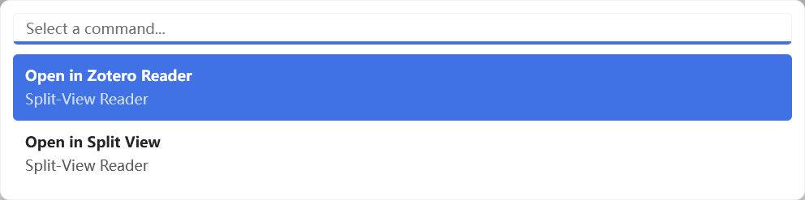
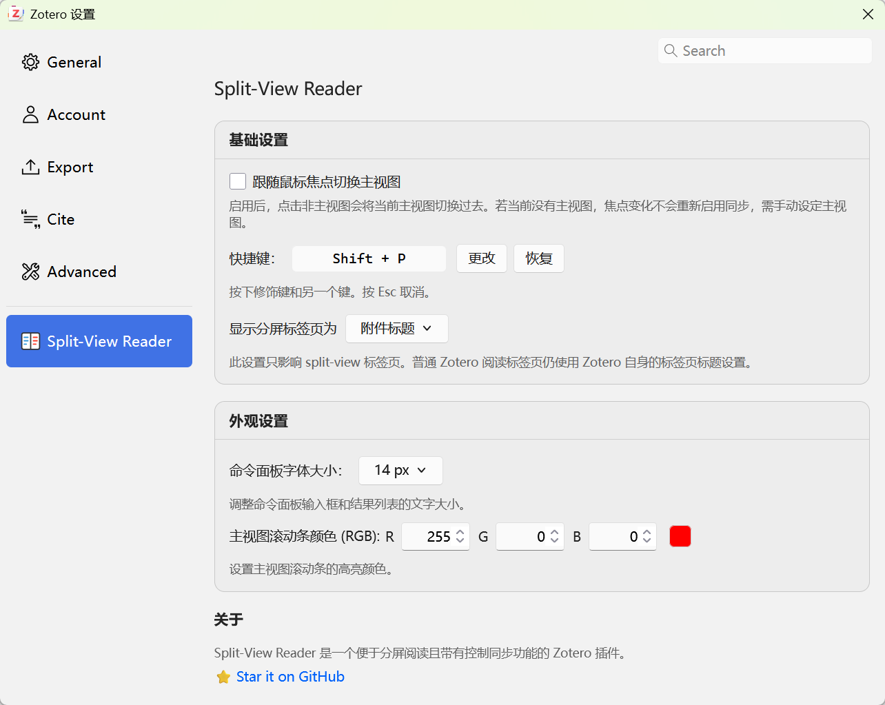

#  Split-View Reader（分屏阅读器）

[English](../README.md) | [简体中文](./README-zhCN.md)

---

**Split-View Reader（分屏阅读器）** 是一款适用于 [Zotero 8/9/10](https://www.zotero.org/) 的插件，支持并排阅读相同或不同的 PDF，并提供可选的主视图操作同步。

  

## 功能特性

- **分屏模式**：在两个并排的窗格中同时查看相同/不同的 PDF 文档
- **同步滚动/缩放**：只要设置了主视图，通过工具栏按钮或鼠标滚轮操作时，从动视图就会跟随主视图进行滚动和缩放
- **独立导航**：取消主视图即可关闭同步，并让两个窗格完全独立导航
- **无缝集成**：与 Zotero 阅读器界面自然融合

## 安装方法

1. 从 [Releases](https://github.com/zerolfl/zotero-split-view-reader/releases) 下载最新的 `.xpi` 文件
2. 在 Zotero 中，点击 `工具` → `插件`
3. 点击齿轮图标，选择 `Install Plugin From File...`
4. 选择下载的 `.xpi` 文件

## 使用方法

### 通过命令面板快速启动

按 `Shift + P` 打开 Zotero 命令面板：选择 **在 Zotero Reader 中打开** 可单独打开附件，选择 **在分屏视图中打开** 可进入分屏模式。

  

### 右键菜单操作

在任一窗格中右键点击，可使用以下选项：

| 选项                            | 说明                                     |
| ------------------------------- | ---------------------------------------- |
| **交换 PDF**                    | 交换左右窗格中的 PDF                     |
| **分离视图**                    | 将分屏中的阅读器恢复为普通 Zotero 标签页 |
| **关闭此视图**                  | 关闭触发右键菜单的视图                   |
| **设为主视图 / 取消主视图**     | 为触发右键菜单的视图设置/取消主视图      |
| **更换此视图中的 PDF**          | 更换触发右键菜单所在视图的 PDF           |
| **使此视图与左侧/右侧视图一致** | 让此视图对齐另一侧视图的位置和缩放       |

一些说明：

- 使用 `Ctrl + 鼠标滚轮` 进行缩放时，该操作保持独立控制，不会触发同步。
- 只有存在主视图时，操作同步才会生效。使用右键菜单中的 **取消主视图** 即可关闭同步。

### 设置

点击 `编辑` → `设置` → 点击 Split-View Reader 进行配置：

- **跟随鼠标焦点切换主视图**：启用后，在已有主视图时，点击另一侧视图会将主视图切换到该侧
  > 如果当前没有主视图，焦点变化不会重新创建主视图；如需重新开启同步，请使用右键菜单中的 **设为主视图**。
- **Show Split Tabs as**：选择分屏标签页标题的显示方式，不影响普通 Zotero 标签页。

  

